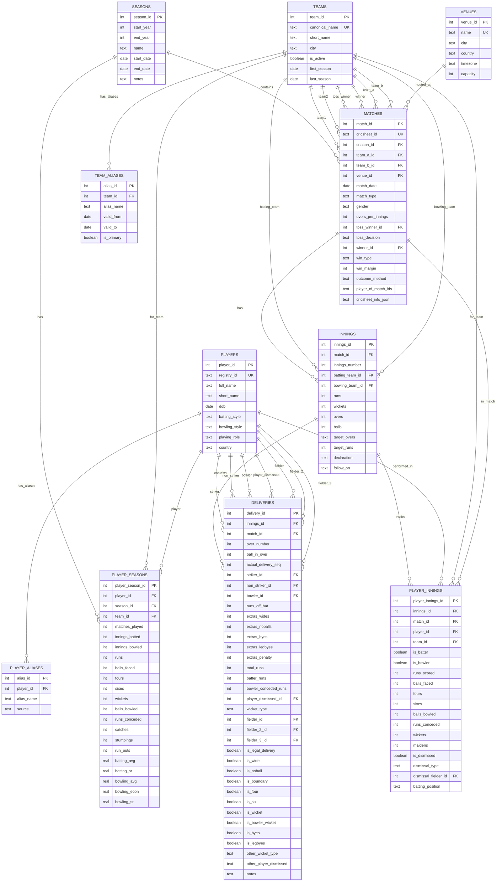

# IPL Analytics Database - Entity Relationship Diagram

## Table Relationships Summary

| Parent Table | Child Table | Relationship | Foreign Key |
|--------------|-------------|--------------|-------------|
| seasons | matches | 1:N | season_id |
| teams | matches (team_a) | 1:N | team_a_id |
| teams | matches (team_b) | 1:N | team_b_id |
| teams | matches (toss_winner) | 1:N | toss_winner_id |
| teams | matches (winner) | 1:N | winner_id |
| venues | matches | 1:N | venue_id |
| matches | innings | 1:N | match_id |
| teams | innings (batting) | 1:N | batting_team_id |
| teams | innings (bowling) | 1:N | bowling_team_id |
| innings | deliveries | 1:N | innings_id |
| matches | deliveries | 1:N | match_id |
| players | deliveries (striker) | 1:N | striker_id |
| players | deliveries (non_striker) | 1:N | non_striker_id |
| players | deliveries (bowler) | 1:N | bowler_id |
| players | deliveries (dismissed) | 1:N | player_dismissed_id |
| players | deliveries (fielder) | 1:N | fielder_id |
| innings | player_innings | 1:N | innings_id |
| matches | player_innings | 1:N | match_id |
| players | player_innings | 1:N | player_id |
| teams | player_innings | 1:N | team_id |
| seasons | player_seasons | 1:N | season_id |
| teams | player_seasons | 1:N | team_id |
| players | player_seasons | 1:N | player_id |
| teams | team_aliases | 1:N | team_id |
| players | player_aliases | 1:N | player_id |

## Key Design Decisions

1. **Canonical Team Names**: Teams table stores canonical names (e.g., "Mumbai Indians") while team_aliases handles historical names ("Mumbai Indians" vs "Mumbai" in early seasons)

2. **Player Registry ID**: Uses Cricsheet's unique registry_id as natural key, with auto-increment player_id as surrogate PK

3. **Deliveries Table**: Contains both raw fields (runs_off_bat, extras_*) and derived cricket-specific fields (is_legal_delivery, batter_runs, bowler_conceded_runs, is_boundary, etc.)

4. **Innings Numbering**: innings_number 1-2 = regular innings, 3+ = super overs

5. **Player Innings**: Single row per player per innings, with boolean flags (is_batter, is_bowler) to track dual roles

6. **Indexes**: All foreign keys indexed; composite indexes on (match_id, innings_number), (player_id, season_id), (innings_id, over_number, ball_in_over)

7. **Views**: Four analytical views (v_batter_career, v_bowler_career, v_batter_season, v_bowler_season) pre-compute career/season aggregates